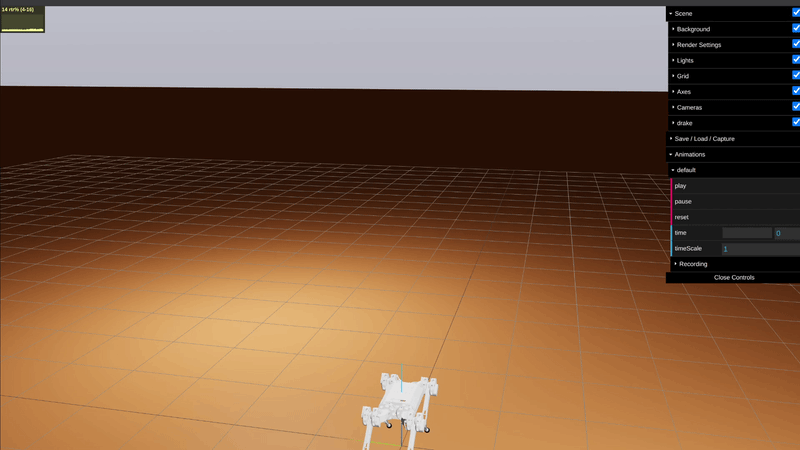

# BledtKim

Physics-based walking controller simulation for the MIT Cheetah (Mini-Cheetah), built with Drake (`pydrake`).

Control stack is based on:
- Bledt et al. (2018), *Contact Model Fusion for Dynamic Legged Robots* — contact state estimation / fusion.
- Kim et al. (2019), *Whole-Body Impulse Control / WBC-MPC* — prioritized inverse dynamics, WBIC QP, MPC.

## Run

```bash
.venv/bin/python src/main.py --robot mini_cheetah --v-des 0.5 --duration 10
```
